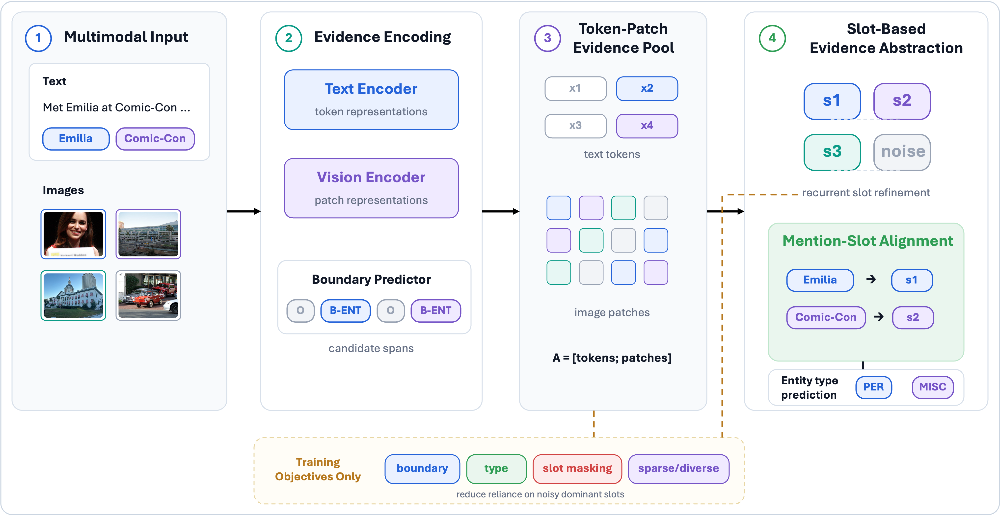
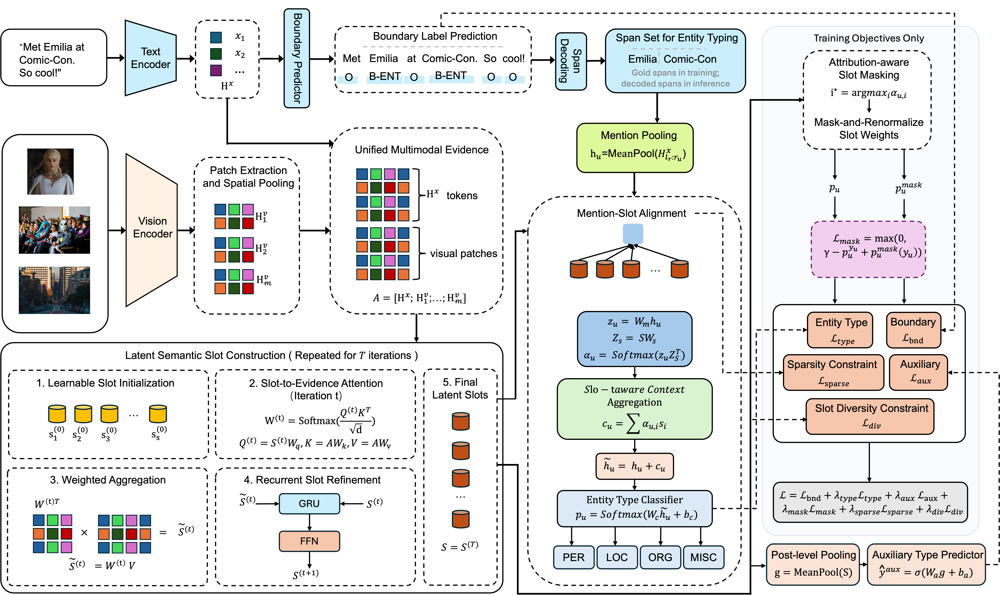

# SLAM: Slot-based Latent Alignment for Multi-Image Multimodal Named Entity Recognition

This repository contains the official implementation of **SLAM**, a slot-based latent alignment framework for **multi-image multimodal named entity recognition (MNER)** under full-resource and limited-supervision settings. SLAM is designed to organize noisy cross-image evidence and select mention-specific slot evidence for entity type prediction.

It includes the model implementation, data loading utilities, training and evaluation entry points, a sample data record, and lightweight release checks.

This repository does not include MNER-MI data or images. Please obtain the dataset from the original benchmark release and convert it to the required JSON format.

## Authors and Contact

Jia Huang, Shuli Zhao, Yaru Zhao, and Binyang Li.

**Corresponding author:** Yaru Zhao ([zhaoyaru@uir.edu.cn](mailto:zhaoyaru@uir.edu.cn)).

**Repository:** [Jialy-lily/SLAM-MNER](https://github.com/Jialy-lily/SLAM-MNER).

Paper and citation details will be added when available.

## Overview



SLAM follows an evidence organization pipeline. Given a post with text and multiple associated images, the model first encodes text tokens and image patches as fine-grained multimodal evidence units. A boundary predictor proposes candidate mention spans from the textual representations. The unified token-patch evidence pool is then abstracted into a small set of latent semantic slots. Finally, each candidate mention selects the most relevant slots through mention-slot alignment, and the selected slot-aware context is used for entity type prediction.

The training objectives are marked as **training only** in the overview figure. They supervise boundary prediction, entity typing, attribution-aware slot masking, and lightweight sparsity/diversity constraints. During inference, SLAM uses the learned encoders, latent slots, mention-slot alignment module, and entity type classifier.

## Detailed Framework



The detailed framework illustrates the full data flow:

1. Text tokens are encoded by a text encoder, while multiple images are encoded by a vision encoder and spatially pooled into patch-level visual evidence.
2. Textual token representations and visual patch representations are concatenated into a unified multimodal evidence pool.
3. Learnable latent semantic slots repeatedly attend to the evidence pool and are refined through recurrent slot updates.
4. Candidate mention spans are obtained from boundary labels. During training, gold spans are used for mention-level type supervision; during inference, decoded spans are used.
5. Each mention is pooled from textual token representations, aligned with relevant slots, and classified with slot-aware context.
6. Training-only objectives include boundary loss, type loss, auxiliary type prediction, attribution-aware slot masking, mention-slot sparsity, and slot diversity.

## Repository Structure

```text
SLAM-MNER/
├── assets/               # overview and detailed framework figures
├── configs/              # example notes and command snippets
├── examples/             # sample JSON data format
├── scripts/              # release checking and helper scripts
├── slam/                 # core package
│   ├── data.py           # dataset loading and limited-supervision sampling
│   ├── model.py          # encoders, latent slots, mention-slot alignment, losses
│   └── utils.py          # training and evaluation utilities
├── train.py              # training entry point
├── eval.py               # evaluation entry point
├── .gitignore            # local data, checkpoints, outputs, and credentials
├── requirements.txt
└── README.md
```

## Environment

Python 3.10+ is recommended. Clone the repository and install dependencies with:

```bash
git clone https://github.com/Jialy-lily/SLAM-MNER.git
cd SLAM-MNER
pip install -r requirements.txt
```

Before releasing or running experiments, you can run the lightweight local check:

```bash
python scripts/check_release.py
```

This check validates Python syntax, the example data format, and common credential and local-path patterns, while allowing the listed public correspondence address. It does not download pretrained models or run training.

## Dataset Format

Each dataset file is a JSON list. Every item should follow the format below:

```json
{
  "id": "sample_0001",
  "text": "Met Emilia at Comic-Con! So cool!",
  "image_paths": ["img1.jpg", "img2.jpg", "img3.jpg"],
  "gold_entities": [
    {"token_start": 1, "token_end": 2, "type": "PER"},
    {"token_start": 3, "token_end": 4, "type": "MISC"}
  ]
}
```

Notes:

- `token_start` is inclusive and `token_end` is exclusive.
- Token indices are based on whitespace tokenization of `text`.
- Entity types follow `{PER, LOC, ORG, MISC}`.
- `image_paths` may be absolute paths or paths relative to `--image_root`.
- Verify that every image path exists before training. Missing or unreadable images are replaced by masked black placeholders.
- `examples/sample_record.json` illustrates the schema; its image filenames are placeholders.

## Training

### Full-Resource Training

```bash
python train.py \
  --train_json /path/to/train.json \
  --val_json /path/to/val.json \
  --image_root /path/to/images \
  --output_dir outputs/full \
  --text_model xlm-roberta-large \
  --vision_model openai/clip-vit-base-patch16 \
  --batch_size 4 \
  --epochs 10 \
  --lr 3e-5 \
  --lambda_mask 0.2 \
  --freeze_vision
```

### Limited-Supervision Training

Use `--low_resource_ratio` to sample both the training and development sets at the requested ratio. Sampling is stratified by image count and entity-type combination, with at least one example per non-empty group, so the realized ratio may differ from the requested ratio. The command-line name is kept for limited-supervision experiments.

```bash
python train.py \
  --train_json /path/to/train.json \
  --val_json /path/to/val.json \
  --image_root /path/to/images \
  --output_dir outputs/limited10 \
  --low_resource_ratio 0.1 \
  --text_model xlm-roberta-large \
  --vision_model openai/clip-vit-base-patch16 \
  --batch_size 4 \
  --epochs 10 \
  --lr 3e-5 \
  --lambda_mask 0.2 \
  --freeze_vision
```

Common limited-supervision ratios are `0.1`, `0.2`, and `0.4`.

## Evaluation

```bash
python eval.py \
  --ckpt outputs/full/best_model.pt \
  --test_json /path/to/test.json \
  --image_root /path/to/images \
  --save_predictions outputs/full/predictions.json \
  --batch_size 4
```

The evaluation script reports entity-level precision, recall, and F1. A prediction is counted as correct only when both the entity span and entity type match the gold annotation.

## Key Options

- `--num_slots`: number of latent semantic slots.
- `--slot_iters`: number of recurrent slot refinement iterations.
- `--pooled_hw`: spatial pooling size for each image.
- `--low_resource_ratio`: ratio of training and development examples used for limited-supervision experiments.
- `--freeze_vision`: freezes the CLIP vision encoder.
- `--lambda_mask`: weight for the attribution-aware slot masking objective.
- `--slot_masking_margin`: margin used by the slot masking objective.

## Training Objectives

The released training script keeps the main SLAM training objective. The loss weights can be adjusted with:

- `--lambda_type`: weight for mention-level entity type prediction.
- `--lambda_aux`: weight for post-level auxiliary type prediction.
- `--lambda_mask`: weight for attribution-aware slot masking.
- `--lambda_bind_sparsity`: weight for mention-slot sparsity regularization.
- `--lambda_slot_diversity`: weight for slot diversity regularization.

## Reproducibility Notes

The local release check validates syntax and packaging only; it does not establish reproduction of the paper results. Reproducing experiments requires the original dataset, images, pretrained encoders, and experiment settings. Dataset files and trained checkpoints are not distributed in this repository.

The current model samples the initial latent slots during evaluation as well as training. Repeated evaluation can therefore vary; retain the random seeds and environment used for reported experiments.

## License

No license has been selected yet. A license will be added after the code and accompanying assets have been reviewed. Public visibility alone does not grant an open-source license.
